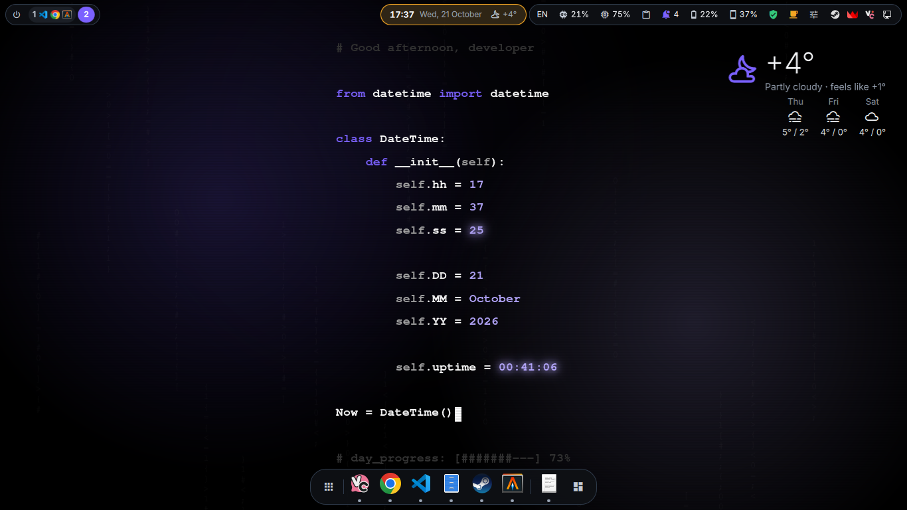
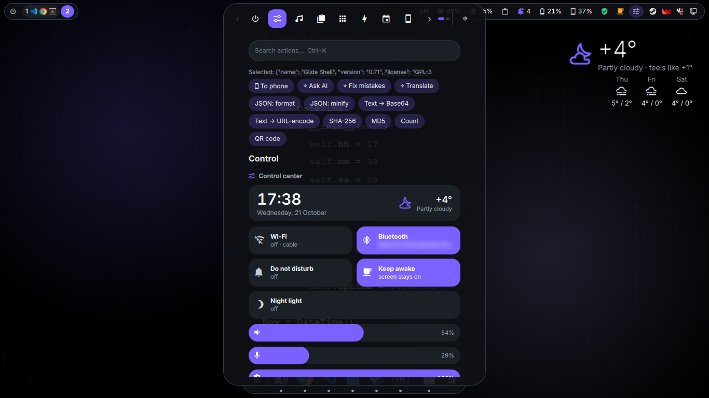
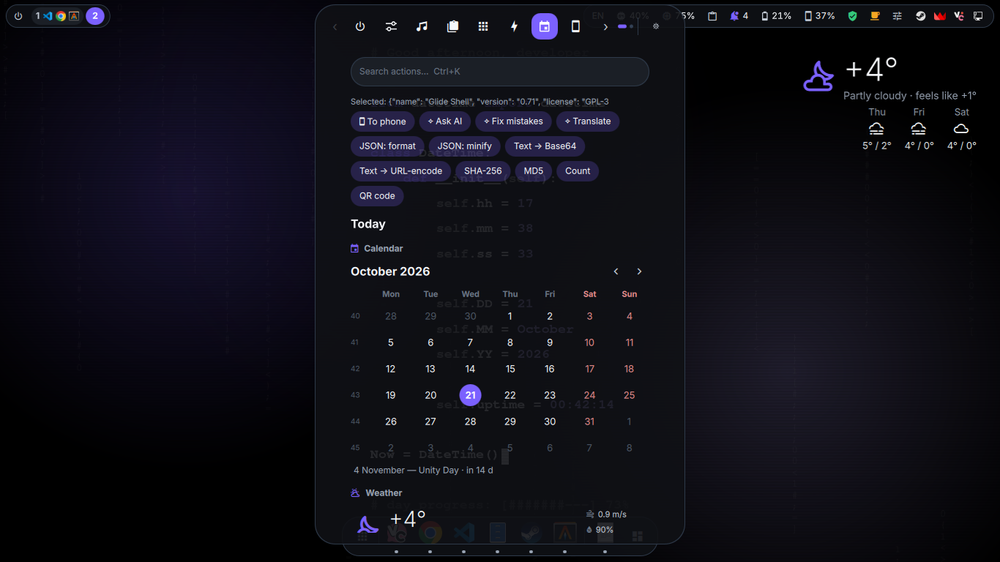
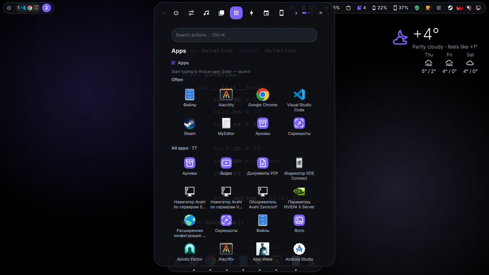
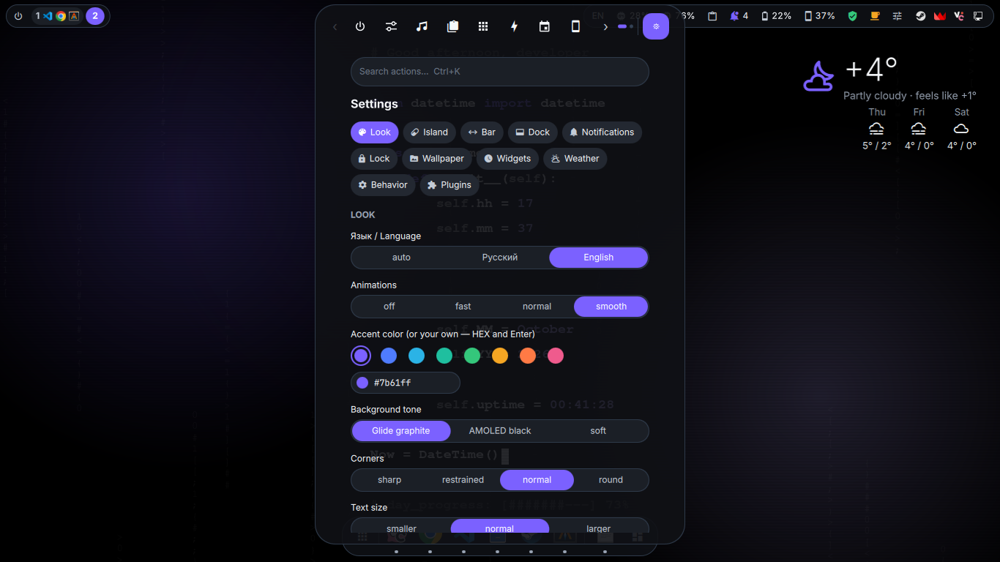
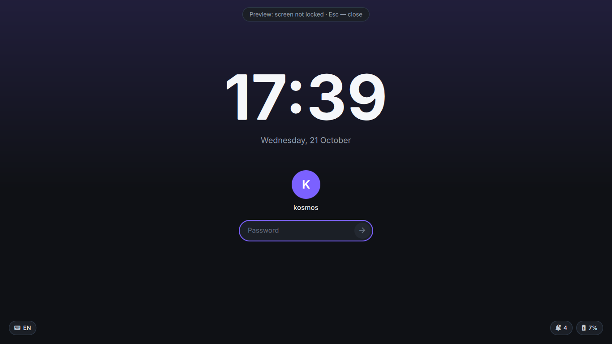
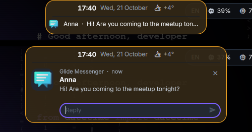
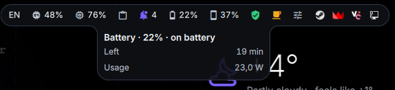

# Glide Shell

**English** · [Русский](README.ru.md)


<sub>1 min 12 s, Russian interface: island and OSD, bar tooltips, tray and dock menus, panel categories, search, live accent colour, notification with inline reply, lock screen, desktop widgets · [MP4](docs/demo.mp4)</sub>

A desktop shell for [niri](https://github.com/YaLTeR/niri), written in QML on [Quickshell](https://quickshell.org).
A top bar of floating capsules with an **island** in the middle, which flows into a panel of categories when
clicked. Around it: a dock, notifications, a polkit password dialog, a lock screen, a login screen (greetd),
wallpapers and desktop widgets. It is meant to replace a whole shell such as DankMaterialShell, and runs as one
service at about 1 % of a core and ~200 MB of RAM. **Everything inside the panel is a plugin** (JSON + scripts,
or QML), so adding your own is easy.

The interface is available in Russian and English (Settings → Look → Language; "auto" follows `$LANG`).
Developed and used daily on Arch Linux with niri 26.04, Quickshell 0.3 and Qt 6.

> **Status:** a personal project that its author uses as their main desktop every day. It works, but it has been
> tested on one laptop with one screen. Multi-monitor setups, other distributions and other app combinations
> are at your own risk for now. Bug reports are welcome. The code comments and the changelog are in Russian.

## Companion apps

[**Glide Apps**](https://github.com/fdhy23qd/Glide-apps) are lightweight apps in the same style that follow the shell's
theme live: Photos (with editing), Video (player and editor), PDF, Screenshots (annotation) and Archives. The
screenshot plugin and the Print keys use Glide Apps' editor when it is installed.

## Screenshots




| | |
|---|---|
|  |  |
| Control centre, with context actions for the selected JSON | Today: calendar with public holidays, and weather |
|  |  |
| App launcher (Mod+D) | Settings |
|  |  <br>  |
| Lock screen | A notification in the island and an inline reply; a bar tooltip |

## Features

- **Island and panel.** The island shows the clock and, as rows below it, whatever is going on: volume and
  brightness OSD, notifications (with inline reply), music with controls, timers, screen recording, short
  confirmations. Click it or hover over it and it springs open into the panel; closing it shrinks back into the island.
- **Panel categories:** quick tools (notes, timer, calculator, colour picker, screenshot, screen recording),
  control centre (Wi-Fi, Bluetooth, sound, per-app mixer, brightness, power profiles, night light), today
  (calendar with Russian public holidays, weather from Open-Meteo), media, clipboard history with images,
  notifications, phone (KDE Connect), task manager, network and developer tools, text tools, an AI chat (Claude)
  and an app launcher. Search across all of them with Ctrl+K or by just typing; the search also finds files
  in your home folder (own lightweight index) and offers a web search as the last result.
- **Context actions:** the panel remembers the selected text when it opens and offers matching actions
  (format JSON, decode a JWT, open a URL, translate…).
- **Top bar:** workspaces with app icons, the focused window, keyboard layout, CPU and RAM, clipboard,
  notifications, battery, phone battery, VPN, "stay awake", tray. Tooltips and the tray menu "drip" out of the capsule.
- **Customisable bar:** choose which items sit in the left and right islands, in which order (volume, microphone,
  Bluetooth, night light, weather, power profile, screenshot and more), and which icons appear next to the island clock.
- **Dock:** pinned and running apps, with smart, autohide and always-visible modes.
- **Notification server and polkit agent** (optional), with do-not-disturb on a schedule or while screen sharing,
  and history that survives restarts.
- **Lock screen** (PAM): locks on `loginctl lock-session`, before sleep and when idle; shows what is playing
  and unread notifications. A crash never unlocks the session.
- **Login screen** for greetd, in the same style (`greeter/`, optional).
- **Wallpapers:** image, folder slideshow, GIF or video (decoded in a separate process, paused under windows
  and on battery). The theme colours can follow the wallpaper.
- **Desktop widgets:** clock, date, weather, music, system, and your own widgets in QML.
- **Device settings for niri** (niri has no GUI of its own): displays (scale, mode, rotation, on/off, VRR and
  arrangement, with a 15-second "keep or revert"), keyboard layouts and repeat, touchpad and mouse, window gaps,
  corners and borders, niri animations, cursor, hot corner, apps at login (XDG autostart) and a key binding editor.
  Written to separate files included from your niri config; every change is checked with `niri validate`.
- **Theme:** accent colour, tone, corner radius, text size, opacity, and animation speed (or no animations at all).
- **Multi-monitor modes:** unite, extend, mirror and standard. These are untested on real hardware.
- **Quick look:** Shift+Space on a file in search previews it right in the list: image, first PDF page, video frame, text.
- **Arch Linux updates:** the number of available packages (repositories and AUR) in the bar; click to update in a terminal.
- **API for other apps:** a D-Bus service `org.glide.Shell` and a `glide-shell` command. Apps can show progress in the
  island, read the theme and follow its changes, open the panel ([docs/API.md](docs/API.md)). The dock shows unread
  counts and download progress from apps that use the Unity LauncherEntry standard (Telegram, browsers, Steam).
- **Updates:** checks the git folder it was installed from every 6 hours and shows what's new; one click runs
  `git pull` and `install.sh` (the Glide apps too, if they were installed from git).
- **Reliability:** runs as a systemd user service and restarts itself after a crash. If it keeps crashing, it falls
  back to DMS when DMS is installed. Apps are launched in their own scopes, so they survive shell restarts.

## Installation

Requirements: niri and Quickshell (on Arch: `pacman -S niri quickshell`). `setup.sh` checks and offers to
install the rest: Python 3, wl-clipboard, libnotify, JetBrainsMono Nerd Font, Inter, NetworkManager and others.

```sh
git clone https://github.com/fdhy23qd/Glide-shell && cd Glide-shell
sh setup.sh               # asks before every change to your system; --yes answers "yes" to everything safe
```

The installer:
- installs missing dependencies with pacman (on other distributions it prints the list);
- finds other bars, notification daemons and polkit agents (DMS, waybar, mako, dunst, swaync, polkit-gnome…),
  whether they are running, in niri autostart or systemd services. It asks once whether to replace them. "Yes"
  stops them right away and removes them from autostart (`--uninstall` restores them). "No" keeps them and turns
  off Glide Shell's own notifications and polkit agent, so the two never fight;
- installs the shell as the `glide-shell.service` systemd user service, started with the graphical session;
- adds key bindings in `~/.config/niri/glide-shell.kdl`, skipping keys you already use. The config is checked
  with `niri validate` and rolled back on error:
  - Mod+D: apps;
  - Super+Alt+L: lock;
  - brightness keys;
  - Mod+Shift+Escape: restart the shell.

Update after `git pull`: `sh install.sh`. It runs the tests, installs the new version and restarts the service.
If the new version fails to load, it rolls back to the previous one, so the bar never disappears.

On the first start a short wizard helps choose the language, colours, island style and dock behaviour.

Remove: `sh setup.sh --uninstall` (settings and data stay; add `--purge` to delete them too).

Optional login screen (needs greetd): `sudo sh greeter/install.sh --enable`. The change takes effect after
a reboot. If something goes wrong, press Ctrl+Alt+F2, log in, run `sudo sh greeter/install.sh --disable` and reboot.

## Usage

- Open the panel: click the island, or bind `qs -c glide-shell ipc call panel toggle` to a key.
- Inside the panel:
  - Esc closes it;
  - Alt+1…9 or Alt+←/→ switch categories;
  - Ctrl+K searches.
- Everything is also scriptable over IPC: `qs -c glide-shell ipc call panel <function>`. Useful functions:
  - `toggle`, `open`, `close`, `launcher`;
  - `category <id>`;
  - `settings`;
  - `flash <text>`;
  - `night on|off|auto|toggle`;
  - `record [system|mic]`;
  - `awake on|off`;
  - `wallpaper <path>|next`;
  - `search <text>` (open the panel with a query, e.g. from a key binding);
  - `pref <key> <json>` (change a setting live, e.g. `pref accent '"#3b82f6"'`).

  The lock screen has its own target: `qs -c glide-shell ipc call lock lock`. To see all functions:
  `qs -c glide-shell ipc show`.
- Logs: `journalctl --user -u glide-shell`. Restart: `systemctl --user restart glide-shell`.

Settings live in the panel (the ⚙ button) and are stored in `~/.config/glide-shell/config.json`. Data (clipboard,
notification history, chat history) goes to `~/.local/state/glide-shell/`, with private files kept at mode 0600.

## Writing a plugin

Full reference: **[docs/API.md](docs/API.md)** (storage, settings, events, bar items, widgets; security and
compatibility rules in section 10). A working
starter plugin: `python3 ~/.config/quickshell/glide-shell/tools/glide-plugin.py new my-plugin`.

Create `~/.config/glide-shell/plugins/<name>/plugin.json`. A plugin with the same `id` as a built-in one
replaces it. More examples are in [`examples/`](examples/).

```json
{
  "id": "my-plugin", "api": 1, "name": "My plugin", "icon": "★", "category": "quick",
  "items": [
    { "type": "button", "label": "Hello", "command": ["notify-send", "Hello"] },
    { "type": "input", "placeholder": "Text → Enter", "command": ["sh", "{dir}/do.sh"] },
    { "type": "list", "filter": true, "list": ["ls", "/tmp"], "command": ["xdg-open", "/tmp/{text}"] }
  ]
}
```

- **Items:** a `button` runs its `command`, an `input` runs on Enter, and a `list` shows the lines its `list`
  command prints and runs `command` with the line you click.
- **Commands:** commands are argv arrays with no shell. Placeholders `{text}` and `{dir}` are filled in, and the
  text is also passed in `$QP_TEXT`. `$QP_FOCUSED` holds the focused window as JSON; `$QP_SELECTION` and
  `$QP_CLIPBOARD` hold the selected and copied text.
- **Options:**
  - `"output": "copy" | "notify"`;
  - `"confirm": true` (the action needs a second click);
  - `"close": false`;
  - `"priority"`;
  - `"keywords"`;
  - `"daemon"` (a background process);
  - `"contextActions"` (buttons shown over the selected text, filtered by `when`: `json`, `url`, `jwt`…).
- **Categories:** a new category is created automatically with
  `"category": "games", "categoryName": "Games", "categoryIcon": "󰊗"`. Icons are JetBrainsMono Nerd Font glyphs.
- **QML plugins:** `"qml": "Widget.qml"` gives the plugin its own interface. The root item receives an `api` object
  (`run`, `close`, `copy`, `flash`, `shown`, `accent`, `openCategory`…). Use the shared design tokens through
  `import qs` + `Theme`.

Plugins run commands with your permissions, so install only the ones you have read.

**Desktop widgets** work the same way: put `widget.json` and `widget.qml` in `~/.config/glide-shell/widgets/<name>/`.
The installer copies a `countdown` example there. In `widget.json`, `settings` builds the widget's options form.

## AI chat

The AI category talks to Claude. It uses Claude Code if it is installed (with your subscription, no key needed),
or the Claude API with a key you put in `~/.config/glide-shell/anthropic-key` yourself. The selected text and your
questions are sent to Anthropic.

## Privacy

- **Clipboard history** stores everything you copy, text and images, in `~/.local/state/glide-shell/` at mode 0600.
  Passwords marked by password managers (KeePassXC and others) are skipped. You can disable it with
  `"disabled": ["clipboard"]` in `config.json`.
- **Weather** sends your approximate location to Open-Meteo. The location is detected from your IP address
  (ipwho.is), or you can enter a city instead.
- **Holidays** send only the year to isdayoff.ru.
- Images embedded in notifications are never loaded from the network.

## Tests

`python3 -m unittest discover -s tests` checks the Python helpers and the translation dictionary. It needs no
network, and `install.sh` runs it before every install.

## License

[GPL-3.0-or-later](LICENSE). You may use, modify and redistribute Glide Shell. Modified versions must stay under
the GPL and come with their source code.
