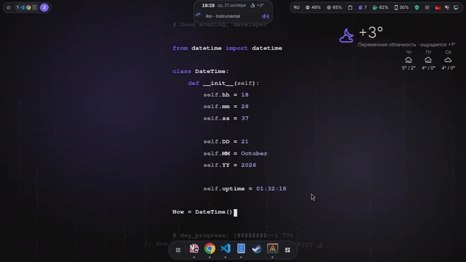
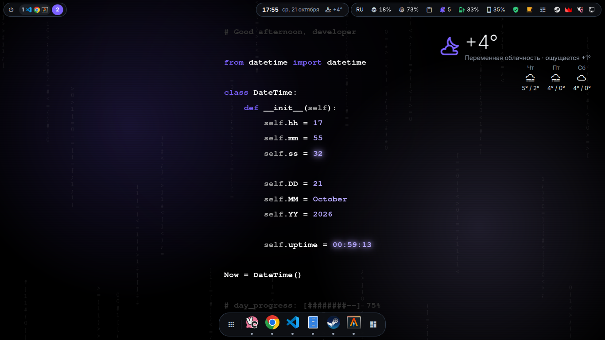
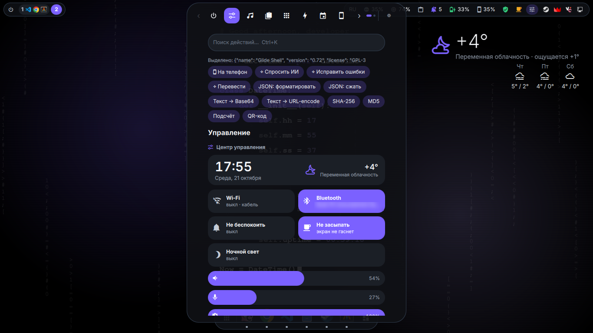
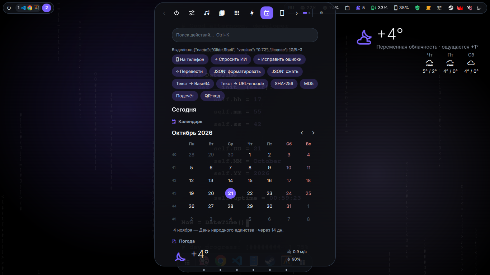
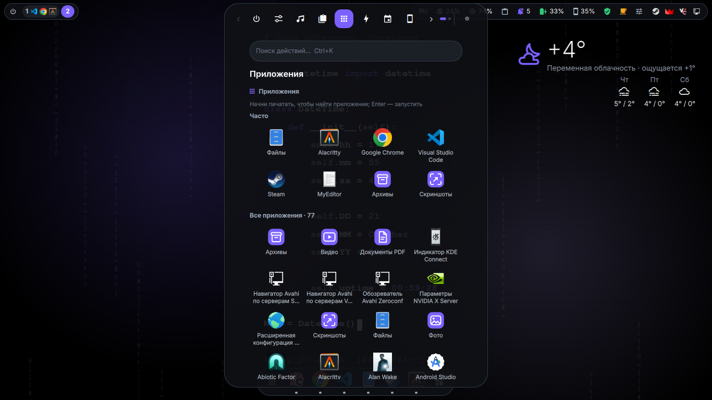
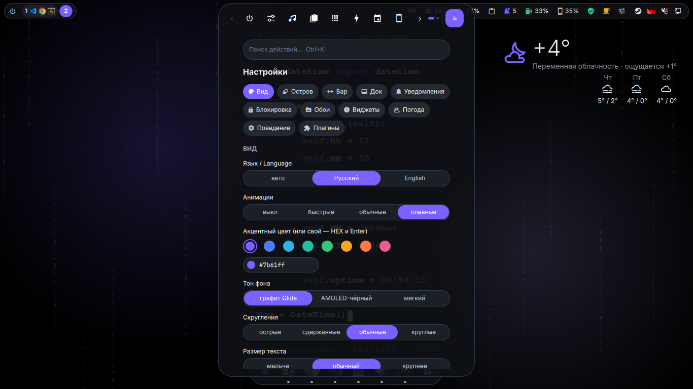
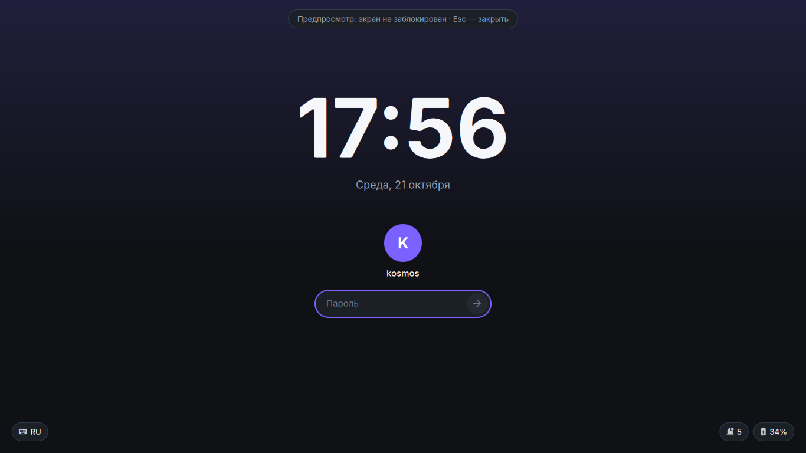
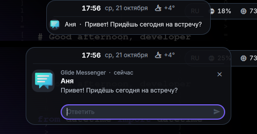
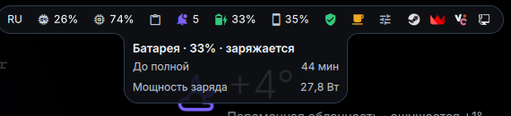

# Glide Shell

[English](README.md) · **Русский**



<sub>1 мин 12 с: остров и OSD, подсказки бара, меню трея и дока, разделы панели, поиск, смена акцента на лету, уведомление с ответом, экран блокировки, виджеты · [MP4](docs/demo.mp4)</sub>

Оболочка рабочего стола для [niri](https://github.com/YaLTeR/niri) на [Quickshell](https://quickshell.org) (QML):
верхний бар из капсул с **островом** по центру, который перетекает в панель с категориями, док, уведомления,
окно пароля polkit, экран блокировки, экран входа, обои и виджеты рабочего стола. Вместо полноценной
оболочки вроде DankMaterialShell — одна служба на ~1 % ядра и ~200 МБ памяти. **Всё содержимое панели — плагины**
(JSON + скрипты или QML), их легко дописать самому.

Интерфейс — русский и английский (настройки → «Вид» → «Язык»). Проверялось на Arch Linux, niri 26.04,
Quickshell 0.3, Qt 6.

> Состояние: личный проект, который автор каждый день использует как основной рабочий стол. Работает, но
> проверен на одной машине и одном мониторе: несколько мониторов, другие дистрибутивы и чужие наборы
> программ — пока на свой страх и риск. Сообщения об ошибках приветствуются.


## Приложения Glide

[**Glide Apps**](https://github.com/fdhy23qd/Glide-apps) — лёгкие приложения в том же стиле, которые подхватывают тему
оболочки на лету: Фото (с правкой), Видео (плеер и редактор), PDF, Скриншоты (разметка) и Архивы. Плагин скриншотов
и клавиши Print открывают редактор из Glide Apps, если он установлен.

## Скриншоты




| | |
|---|---|
|  |  |
| Центр управления; сверху — действия для выделенного JSON | «Сегодня»: календарь с праздниками и погода |
|  |  |
| Приложения (Mod+D) | Настройки |
|  |  <br>  |
| Экран блокировки | Уведомление в острове и ответ прямо в нём; подсказка капсулы бара |

## Установка на новый компьютер

Нужны niri и Quickshell (в Arch — пакеты `niri` и `quickshell`).

```sh
git clone https://github.com/fdhy23qd/Glide-shell && cd Glide-shell
sh setup.sh               # спрашивает перед каждым изменением; --yes — без вопросов
sh setup.sh --uninstall   # убрать (настройки остаются; --purge — и их)
```

Установщик: проверяет зависимости и предлагает поставить недостающие через pacman (на другом дистрибутиве — пишет
список); находит другие бары, демоны уведомлений и polkit-агенты (DMS, waybar, mako, swaync, dunst, polkit-gnome…) —
запущенные, в автозапуске niri и службами systemd, а также любую программу, держащую уведомления, — и одним вопросом
предлагает заменить их: «да» — останавливает сразу, убирает из автозапуска и не даёт шине поднять их демон заново
(уведомления заработают без перезахода; `--uninstall` вернёт всё как было), «нет» — оставляет их, а у Glide Shell
выключает уведомления и окно пароля (и при переустановке тоже); ставит оболочку службой systemd (`install.sh`);
создаёт первые настройки (плагин расписания пар одного вуза — СыктГУ — выключен); добавляет клавиши в `~/.config/niri/glide-shell.kdl`
(Mod+D — приложения, Super+Alt+L — замок, яркость, Mod+Shift+Escape — перезапуск) — занятые у пользователя
пропускает, конфиг проверяет `niri validate` и при ошибке возвращает как было. Копии изменённых файлов — рядом.

## Установка
```sh
sh install.sh      # из папки проекта: копирует в ~/.config/quickshell/glide-shell и перезапускает
```
Обновляя, всегда запускай `install.sh` заново: он удаляет старую копию и перезапускает панель.
(Обычный `cp -r . ~/.config/quickshell/glide-shell` поверх существующей папки кладёт
новую версию *внутрь* старой, и продолжает работать старая.)

Glide Shell работает **службой systemd** `glide-shell.service` (ставит и включает `install.sh`, запускается
вместе с графическим сеансом): упала — через пару секунд поднимается снова, и если экран был заперт,
запирает его снова. Падает раз за разом (5 раз за 3 минуты) — `glide-shell-rescue.service` запускает DMS, если
он установлен, чтобы остался рабочий стол, а без DMS — пробует ещё раз и шлёт уведомление, где смотреть причину
(при запертом экране — ничего не делает: падение не должно снимать блокировку).
Приложения из лаунчера и дока запускаются каждое в своей группе (`systemd-run --scope`) и перезапуск
оболочки переживают.
```sh
systemctl --user status glide-shell          # состояние
systemctl --user restart glide-shell         # перезапуск
journalctl --user -u glide-shell -f          # лог; в начале — строка `Glide Shell v0.77`
```
При первом запуске `install.sh` переносит данные со старого имени: `~/.config/quickpanel` →
`~/.config/glide-shell`, `~/.local/state/quickpanel` → `~/.local/state/glide-shell`,
`~/quickpanel-notes.md` → `~/glide-notes.md`. Переменные `QP_*` для плагинов не менялись.

**Аварийный откат** (если Glide Shell сломался и пропал бар): Mod+Shift+Escape или из TTY
`sh ~/.config/quickshell/glide-shell/tools/glide-rescue.sh` — если установлен DMS, останавливает Glide Shell
и запускает DMS до перезахода (`… glide-rescue.sh undo` — обратно); без DMS — перезапускает Glide Shell. Если экран заперт блокировкой Glide Shell и она
не снимается — тот же скрипт из TTY (Ctrl+Alt+F2, вход по паролю) перезапускает Glide Shell в
тестовом режиме, и замок снимается сам через 60 с.

`~/.config/niri/config.kdl`:
```kdl
// spawn-at-startup для Glide Shell не нужен — его запускает systemd (graphical-session.target)
binds {
    Mod+Shift+Escape { spawn "sh" "-c" "sh ~/.config/quickshell/glide-shell/tools/glide-rescue.sh"; }
    Super+Alt+L { spawn "qs" "-c" "glide-shell" "ipc" "call" "lock" "lock"; }   // экран блокировки
    // яркость через logind (без root и brightnessctl), значение показывает остров
    XF86MonBrightnessUp   allow-when-locked=true { spawn-sh "sh ~/.config/quickshell/glide-shell/tools/glide-brightness.sh +10"; }
    XF86MonBrightnessDown allow-when-locked=true { spawn-sh "sh ~/.config/quickshell/glide-shell/tools/glide-brightness.sh -10"; }
    Mod+D     { spawn "qs" "-c" "glide-shell" "ipc" "call" "panel" "launcher"; }   // приложения
    Mod+Grave { spawn "qs" "-c" "glide-shell" "ipc" "call" "panel" "toggle"; }
    Mod+M     { spawn "qs" "-c" "glide-shell" "ipc" "call" "panel" "category" "media"; }
    Mod+V     { spawn "qs" "-c" "glide-shell" "ipc" "call" "panel" "category" "clipboard"; }
}
```
Хоткей категории открывает её сразу, повторное нажатие закрывает панель.
Клавиши внутри: Esc — закрыть, Alt+1…9 / Alt+←→ — категории, Alt+↑↓ (PgUp/PgDn) — страницы
категорий, Alt+, — настройки.
Зависимости (setup.sh проверяет и ставит сам): `quickshell`, `niri`, `python3`, `wl-clipboard`, `libnotify`,
шрифты JetBrainsMono Nerd Font (значки) и Inter; по желанию — NetworkManager (Wi-Fi), BlueZ, UPower и
power-profiles-daemon, KDE Connect, `wlsunset` (ночной свет), `wf-recorder` + `slurp` (запись экрана), greetd (экран входа).

## Остров
По умолчанию панель — чёрный остров сверху по центру: со своим баром — его центр, без него —
сразу под чужим баром (в настройках: «Поверх бара»).
Клик или наведение — и остров пружиной перетекает в панель с вкладками категорий; закрываясь,
панель сжимается обратно в остров. Анимации прерываемые: можно закрыть на середине открытия.
- **Музыка** (любой MPRIS-плеер): обложка, название и эквалайзер. Наведение раскрывает управление
  и прогресс, средняя кнопка — пауза, клик открывает категорию плеера.
- **Таймер** (плагин «Таймер»): кольцо и остаток; наведение — крупный отсчёт и отмена ✕.
  Без своего бара остров показывает одну активность, а таймер при играющей музыке уходит
  в пузырёк справа; со своим баром все активности идут строками под часами (см. «Верхний бар»).
- **Громкость и яркость (OSD):** при изменении громкости, микрофона, яркости, профиля питания или
  выхода звука остров на полторы секунды показывает строку со значком, полосой и значением
  (клик — центр управления). Всплывашки DMS на это время выключены; аварийный откат включает их обратно.
- **Подтверждения:** после действия остров коротко показывает «✓ название».
  Своё сообщение: `qs -c glide-shell ipc call panel flash "Готово"`, из QML-плагина — `api.flash(icon, text, color)`.
- Без своего бара в покое наведение показывает категории (клик открывает нужную), если открытие
  наведением выключено.

Вид меняется в настройках: «Вид панели» → «рейка у края» возвращает прежнюю боковую панель;
свой бар с островом при этом остаётся.

## Верхний бар
Вместе с островом панель рисует свой бар (замена бара DMS) из плавающих капсул:
- **слева:** питание (категория «Питание»), занятые воркспейсы niri с иконками приложений
  (клик — перейти, колесо — листать), активное окно (клик — переключатель окон);
- **по центру:** остров — сверху всегда часы и дата, а музыка, таймер и подтверждения выезжают
  под ними строками того же острова (наведение раскрывает строки: кнопки плеера, отмена таймера);
- **справа:** раскладка (клик — следующая), CPU и RAM (клик — «Состояние системы»), буфер,
  уведомления (клик — центр уведомлений DMS, правый клик — «не беспокоить»), батарея,
  центр управления и трей (правый клик — меню).

**Центр управления** (категория «Управление», ≡ в баре): Wi-Fi, Bluetooth и устройства,
«не беспокоить» (его ведёт DMS) и «не засыпать», громкость, микрофон, яркость (через logind,
без root), выход звука, батарея и профиль питания.

**«Не засыпать»** ведёт сам Glide Shell: Wayland idle-inhibit (экран не гаснет) и `systemd-inhibit
idle:sleep` (система не засыпает). Включается в центре управления, в «Переключателях» или
`ipc call panel awake on|off|toggle`; пока включено, в баре горит чашка. Состояние —
`~/.local/state/glide-shell/awake`, переживает перезапуск.

## Док
Внизу экрана: «Приложения», закреплённые приложения, затем запущенные (за разделителем), «Обзор» niri.
Под значком точка — приложение открыто, вытянутая — в фокусе; число — сколько окон.
- **Левый клик** — запустить или перейти к последнему окну; повторный — следующее окно приложения.
  Пока приложение запускается, значок подпрыгивает.
- **Средний клик** — новое окно. **Колесо** над значком — листать окна.
- **Правый клик** — меню: окна приложения (клик — перейти), «Новое окно», «Закрепить/Открепить»,
  «Сдвинуть ←/→», «Закрыть все окна».
- **Когда показывать** (настройки → «Док»): *умно* — на пустом воркспейсе и при подведении мыши к
  нижнему краю; *по наведению*; *всегда* — окна не заходят под док. Размер значков: 32/40/48.
Закреплённые при первом запуске переносятся из дока DMS (`pinnedApps`), дальше — `dockPinned` в config.json.

Пока работает DMS, его бар нужно выключить (`barConfigs[].enabled: false` в
`~/.config/DankMaterialShell/settings.json`).
Свой бар выключается в настройках панели: «Свой верхний бар». Значки — из JetBrainsMono Nerd Font.

## Уведомления и окно пароля
Свой сервер уведомлений: новое уведомление встаёт строкой под часами острова (наведение — текст,
кнопки действий, ✕; клик — действие по умолчанию или окно приложения). Держится 3–12 с, срочное —
пока не закроют. История (до 50, переживает перезапуск), «не беспокоить» и «очистить» — категория
«Уведомления» в панели; колокольчик в баре показывает непрочитанные (правый клик — «не беспокоить»).
Окно пароля polkit — для pkexec, «Дисков», NetworkManager и т. п.; пароль уходит прямо в polkit.

Включаются в настройках → «Уведомления» (`notifications`, `polkit` в config.json). Если уведомления уже держит
другая программа (mako, dunst, swaync, DMS…), их нужно выбрать что-то одно: имя `org.freedesktop.Notifications`
и агент polkit в сеансе — лишь у одного. setup.sh спрашивает об этом сам.

## Тема для обоев
`ThemeSync.qml` пишет палитру в формате DMS (`colors.dark`, `dank16`) в `~/.cache/glide-shell/colors.json`:
фон и текст — чёрный, белый и серые, цветные — акцент и его светлый/тёмный оттенки. Её могут читать другие
программы — например, HTML-обои webpaper (отдельная программа автора, в репозиторий не входит; режим обоев
«сцена» нужен только с ней, без неё — режим «картинка»).

## Переход с DMS
Glide Shell задуман как замена DankMaterialShell целиком: бар, док, OSD, уведомления, polkit, блокировка, экран
входа. setup.sh находит запущенный DMS и предлагает убрать его из автозапуска niri. Файлы `~/.config/niri/dms/*.kdl`
(отступы, скругления, рамки, мониторы) остаются как есть — niri продолжает их читать. Пакет DMS можно оставить:
им пользуется аварийный откат.

## Экран блокировки
Часы, дата, пользователь, поле пароля, раскладка (клик — переключить), батарея, что играет (с кнопками) и число непрочитанных уведомлений (без текста). Пароль проверяет
PAM по стеку `/etc/pam.d/login`, как при входе в систему (в том числе faillock: после 3 неверных
попыток вход закрывается на 10 минут). Разблокировка — только при успешной проверке.
```sh
qs -c glide-shell ipc call lock preview   # тот же экран обычным окном, без блокировки: проверить пароль (Esc — закрыть)
qs -c glide-shell ipc call lock test      # настоящая блокировка, но снимется сама через 60 с
qs -c glide-shell ipc call lock lock      # блокировка
qs -c glide-shell ipc call lock status    # lock | test | preview | unlocked
```
Пока экран заперт, режим лежит в `$XDG_RUNTIME_DIR/glide-shell-lock`. Если оболочка упадёт, niri
оставит сессию запертой (пустой экран), а перезапущенная оболочка запрёт её снова — снять паролем.
Запирают экран: Super+Alt+L, `loginctl lock-session` (и «Заблокировать экран» в панели) и — если
включено «Блокировать перед сном» (настройки → «Блокировка», по умолчанию да) — уход в сон: пока
замок не встал, сон придерживает delay-блокировка systemd. `loginctl unlock-session` не снимает
замок — только пароль. `LockedHint` сессии выставляется. У DMS реакция на logind выключена
(`loginctlLockIntegration: false`; аварийный откат включает её обратно).

Бездействие (настройки → «Блокировка»): экран гаснет через 5 мин и блокируется через 10 (можно
поменять или выключить); на экране блокировки гаснет через минуту. «Не засыпать» и видео (idle-inhibit)
откладывают и то и другое. Переходы: перед замком экран плавно темнеет, после верного пароля поле
вспыхивает зелёным, содержимое уплывает вверх, и фон растворяется над рабочим столом. Перед сном и
после сбоя замок ставится сразу, без анимации; сон во время ухода экрана отменяет разблокировку.

## Возможности ядра
- **Поиск** (Ctrl+K или просто начни печатать): приложения (с иконками, часто запускаемые выше),
  плагины и кнопки во всех категориях; ↑↓ выбирают результат, Enter запускает.
- **Лаунчер** (Mod+D, `ipc call panel launcher`): категория «Приложения» — частые сверху, ниже все
  по алфавиту; число запусков хранится в `~/.local/state/glide-shell/apps.json`. Приложения с
  `Terminal=true` открываются в `$TERMINAL` (иначе alacritty).
- **Контекстные действия:** в момент вызова панель запоминает выделенный текст (`wl-paste --primary`)
  и буфер. Вверху появляются кнопки, подходящие к этому тексту: JSON → форматировать, JWT → декодировать,
  URL → открыть/заголовки/SSL и т.д.
- **Категории** с вкладками в острове (или рейкой у края), хоткей на каждую, Alt+1…9.
- **Профили:** `qs -c glide-shell ipc call panel profile study` (`default` — сбросить).
- **Страницы категорий:** если категорий больше, чем помещается на странице рейки (по умолчанию 6),
  остальные уходят на следующие страницы — стрелки, точки внизу рейки или колесо мыши над ней.
- **Настройки** (⚙ в рейке, `ipc call panel settings`):
  - *поведение:* вид (остров/рейка), свой бар, открытие наведением и задержка;
  - *вид:* анимации и их скорость, акцентный цвет, упругость пружин острова, ширина панели,
    категорий на странице, затемнение фона;
  - *остров:* музыка (эквалайзер: плавный / экономный / неподвижный; через сколько прятать после паузы),
    подтверждения действий и их длительность;
  - *бар:* формат даты у часов, секунды, все/только занятые воркспейсы, иконки приложений,
    видимость каждого элемента бара;
  - порядок категорий, включение плагинов, сброс (со второго нажатия).
  Сохраняются в `~/.config/glide-shell/config.json` (раздел `"panel"`, а также `"disabled"` и `"categoryOrder"`).

## Категории и встроенные плагины
- **Быстро:** заметка (+ последние заметки), таймер, скриншот, калькулятор с историей, переключение окон
  niri с поиском, пипетка цвета (`niri msg pick-color`), переключатели Wi-Fi / Bluetooth / «не засыпать»,
  **запись экрана** — весь экран или область, без звука / со звуком системы / с микрофоном; идёт и с закрытой
  панелью: строка в острове с таймером, клик — стоп; видео в `~/Видео/Записи экрана`. Нужны `wf-recorder`
  (и `slurp` для области): `sudo pacman -S wf-recorder slurp`. Хоткей: `qs -c glide-shell ipc call panel record`
  (с аргументом `system` или `mic` — со звуком) — начать или остановить.
- **Управление:** центр управления (см. «Верхний бар»); **Wi-Fi** — сети рядом (сканирует, пока панель
  открыта; 5 лучших, остальные по «Ещё»), клик по сети — подключить, ввести пароль, отключить, забыть.
  Пароль уходит прямо в NetworkManager. **Bluetooth** — «Мои устройства» (подключить, отключить, забыть,
  заряд) и «Рядом» (поиск, пока панель открыта; клик — сопрячь, довериться и подключить). Коды при
  сопряжении спрашивает окно агента (`tools/glide-bt-agent.py` работает, пока Bluetooth включён);
  выключатель сам снимает блокировку rfkill. **Микшер** — громкость каждого приложения, которое сейчас
  играет звук (перетаскивание, колесо, клик по значку — без звука), и выбор микрофона, если их несколько
  (например, встроенный и гарнитура Bluetooth).
- **Телефон** (KDE Connect, `tools/glide-kdeconnect.py`): карточка устройства и действия — найти, пинг, буфер,
  файлы на телефон (выбор — zenity), файлы телефона (SFTP), SMS (kdeconnect-sms), текст или ссылка; заряд в баре.
  Уведомления телефона приходят в общий центр сами. Выключается в «Поведение».
- **Расписание** (СыктГУ): пары группы на эту или следующую неделю — время, предмет, тип, преподаватель,
  аудитория; сегодняшний день открыт сразу, идущая пара подсвечена. Группа — клик по её названию.
- **Уведомления:** история, «не беспокоить», очистка (см. «Уведомления и окно пароля»)
- **Сегодня** (клик по часам в острове): календарь (неделя с понедельника, номера недель, ‹ › и колесо
  листают месяцы) и погода — сейчас, по часам, на 5 дней, восход/закат. Погода — Open-Meteo без ключа,
  раз в 30 минут; город — сам (по IP, а если IP из другого часового пояса, например через VPN, — город
  системного пояса) или вручную: «сменить» под прогнозом. Температура видна у часов в острове.
- **ИИ:** чат с Claude, см. ниже
- **Медиа:** плеер (любой MPRIS)
- **Буфер:** история текста с поиском
- **Разработка:** папка текущего окна, сниппеты, инструменты (UUID, пароль, JSON, XML, JWT, Base64, URL, хеши, RegEx, timestamp)
- **Текст:** регистр, snake/camelCase, подсчёт, очистка, сортировка, QR (нужен `qrencode`)
- **Система:** **диспетчер задач** (графики процессора и памяти за 2 минуты, процессы с поиском,
  сортировкой по ЦП/памяти/имени, «завершить» и «убить» — со второго нажатия; CPU/RAM в баре открывают его),
  метрики (диск, GPU NVIDIA, температура, батарея, сеть), звук (`pactl`), службы `systemctl --user`, питание (блокировка, сон, выход, перезагрузка, выключение —
  опасные действия со второго нажатия)
- **Сеть:** ping, DNS, SSL-сертификат, HTTP-заголовки, внешний IP
- **Питание:** блокировка, выключение мониторов, сон, выход, перезагрузка, выключение (⏻ в баре)

### ИИ (Claude)
Работает в облаке, на компьютере ничего тяжёлого не запускается. Два способа, выбирается первый доступный:
1. **Claude Code** — по подписке Claude, ключ не нужен. Панель находит `claude` в PATH или бинарник из
   расширения VS Code. Достаточно один раз войти в аккаунт в Claude Code.
2. **Claude API** — оплата за токены. Ключ из console.anthropic.com положи в
   `~/.config/glide-shell/anthropic-key` (или `$ANTHROPIC_API_KEY`), затем в чате нажми «Настроить API»
   (ставит SDK `anthropic` в `~/.local/share/glide-shell/ai-venv`). Модель по умолчанию `claude-opus-5-5`.

Чат: Enter — отправить, Shift+Enter — новая строка, ■ — остановить ответ, ⧉ — скопировать ответ.
История — `~/.local/state/glide-shell/ai-chat.json` (0600), «＋ Новый чат» начинает заново.
Над выделенным текстом появляются действия: **Спросить ИИ** (открывает чат с этим текстом),
**Исправить ошибки** и **Перевести** (результат в буфер), **Пересказать**.
Переменные: `QP_AI_BACKEND=claude|api`, `QP_AI_MODEL`, `QP_CLAUDE` (путь к бинарнику).
Учти: выделенный текст и вопросы уходят в Anthropic.

Категория — поле `"category"` плагина (строка или массив: плагин может стоять в нескольких категориях).
Новая категория создаётся сама: `"category": "games", "categoryName": "Игры", "categoryIcon": "󰊗"`.
Значки (`"icon"`, `"categoryIcon"`) рисуются шрифтом JetBrainsMono Nerd Font: подходят и обычные
символы, и значки Material Design (`nf-md-*`, коды U+F0001…), например 󰊗 — геймпад.

`~/.config/glide-shell/config.json`:
```json
{ "categoryOrder": ["clipboard", "media"],
  "categories": {"media": {"name": "Музыка", "icon": "♪"}},
  "disabled": ["timer"], "order": ["notes"],
  "placement": {"notes": ["quick", "dev"]},
  "profiles": {
    "study":  {"categories": ["text", "quick"], "disabled": ["docker"]},
    "server": {"categories": ["net", "system", "dev"]}
  } }
```

## Написать плагин
Папка `~/.config/glide-shell/plugins/<имя>/` с `plugin.json` (тот же `id` заменяет встроенный;
примеры — в `examples/`). Список перечитывается при каждом открытии панели.
```json
{
  "id": "my-plugin", "api": 1, "name": "Мой плагин", "icon": "★", "category": "quick",
  "items": [
    { "type": "button", "label": "Привет", "command": ["notify-send", "Привет"] },
    { "type": "input", "placeholder": "Текст → Enter", "autofocus": true, "command": ["sh", "{dir}/do.sh"] },
    { "type": "list", "filter": true, "list": ["ls", "/tmp"], "command": ["xdg-open", "/tmp/{text}"] }
  ]
}
```
- `button` запускает `command`; `input` — по Enter с введённым текстом; `list` — строки из stdout `list`,
  клик запускает `command` с выбранной строкой. Строка `значение<TAB>подпись` показывает подпись,
  а в `{text}` отдаёт значение. `"filter": true` добавляет поиск, `"max"` — число строк.
- В `command` подстановки `{text}` и `{dir}`; это argv без shell, текст есть и в `$QP_TEXT`.
- `$QP_FOCUSED` — JSON окна, из которого вызвали панель (`app_id`, `title`, `pid`).
  `$QP_STYLE` — `island` или `edge`.
- `"close": false` — не закрывать панель после действия (списки при этом обновятся).
- `"confirm": true` у кнопки — срабатывает только со второго нажатия (за 3 секунды).
- `"handoff": "<id плагина>"` (с необязательным `"prompt"`) — вместо команды передать текст
  другому плагину и открыть его категорию; QML-плагин забирает текст через `api.takeHandoff(id)`.
- `"wide": true` — категория с этим плагином показывается в широкой карточке.
- `"priority": 20` — место в категории: больше — выше (по умолчанию 0; `"order"` в config.json главнее).
- `"output": "copy" | "notify" | "copy+notify"` — stdout команды копируется в буфер и/или показывается
  уведомлением; ошибка (ненулевой код) тоже придёт уведомлением.
- `"contextActions": [{"label", "when", "command", "output"}]` — кнопки над выделением/буфером.
  `when`: `text` (по умолчанию), `multiline`, `json`, `xml`, `url`, `host`, `jwt`, `number`, `timestamp`, `path`,
  `base64`, `urlenc` или массив (достаточно одного). Команда получает текст в `{text}` и `$QP_TEXT`.
- `"keywords": [...]` — дополнительные слова для поиска. `$QP_SELECTION` и `$QP_CLIPBOARD` — текст
  выделения и буфера на момент вызова панели.
- `"daemon": [...]` — фоновый процесс, стартует вместе с панелью (так работает история буфера).
- `"qml": "Widget.qml"` — свой интерфейс; свойство `api`: `api.run(argv, text)`, `api.close()`,
  `api.copy(text)`, `api.flash(icon, text, color)` (сообщение в острове), `api.shown`,
  `api.contextText` (выделение/буфер), `api.handoff` / `api.takeHandoff(id)`,
  `api.accent` (акцентный цвет из настроек), `api.accentText` (текст на акценте), `api.iconFont` (шрифт значков).
  Если у корня плагина есть свойство `pluginDir`, ядро запишет туда папку плагина. Если QML не собрался,
  в разделе плагина показывается текст ошибки.
  В QML-плагине доступны модули Quickshell (`Quickshell.Services.Mpris`, `.Pipewire` и т.д.).

## Дизайн
Стиль Glide: структура Material 3 и токены Glide Messenger — фон `#0f1115`, поверхности `#1b1f26`,
обводки `#2e3a4a`, акцент `#7b61ff`, текст `#f5f7fa` / `#9aa5b5`, скругления 12–28. Все цвета
и формы — в `Theme.qml`; акцент выбирается в настройках, текст на нём (`accentText`) подбирается
сам: белый или тёмный. Шрифт системный. QML-плагины получают `api.accent` и `api.accentText`.

## Экран входа (greeter/)

Свой экран входа для greetd вместо dms-greeter: как замок Glide Shell (часы, фон, акцент и тон берутся из настроек
пользователя), выбор пользователя и сеанса, раскладка, Caps Lock, батарея, сон/перезагрузка/выключение,
двухфакторные вопросы PAM, память последнего входа (`/var/cache/glide-greeter`). Устроен как dms-greeter:
greetd → `glide-greeter` → свой niri (`/usr/local/share/glide-greeter/niri.kdl`: раскладки и мониторы — из конфига
niri пользователя) → Quickshell. Вошёл — Quickshell и niri выходят, greetd запускает сеанс.

```sh
sudo sh greeter/install.sh             # только файлы — вход не меняется
sudo sh greeter/install.sh --enable    # + greetd запускает экран входа Glide (копия конфига — рядом)
sudo sh greeter/install.sh --disable   # вернуть прежний (из копии)
```

greetd не перезапускается (это выкинуло бы из сеанса) — экран появится после перезагрузки. Если что-то не так:
Ctrl+Alt+F2 → вход в консоли → `sudo sh …/greeter/install.sh --disable` → `reboot`.
Проверка без настоящего входа: `greeter/test/fake-greetd.py` (имитатор протокола greetd; пароль `glide`,
`2fa` → код `123456`) и `GREETD_SOCK=… GLIDE_GREETER_TEST=1 [GLIDE_GREETER_AUTOTYPE="nope,glide"] qs -p greeter`.

## Свои виджеты рабочего стола

Папка `~/.config/glide-shell/widgets/<имя>/` (при первой установке там пример `countdown` — обратный отсчёт):

- `widget.json` — `{"name", "icon": "F051F" (код значка MDI), "description", "stats": true (нужны api.cpu/mem),
  "settings": [{"key", "type": "text|toggle|choice", "label", "default", "options": [{"label", "value"}]}]}` —
  из `settings` строятся поля в «Виджетах»;
- `widget.qml` — корневой элемент с `property var api` и `property var cfg` (значения настроек), размер — его
  `implicitWidth/implicitHeight`. `api`: `now` (дата, раз в минуту), `k` (масштаб из «Размера»), `tint`/`sub`
  (цвета текста из «Цвета»), `accent`, `theme` (все токены Theme), `iconFont`, `weather` (Weather: `data.now`,
  `data.days`, `temp()`, `icon()`, `describe()`), `player` (MPRIS или null), `cpu`, `mem`, `run(argv)`, `openUrl(url)`.

«Виджеты» → «+ имя» добавляет, «Обновить» — перечитать папку, «Папка виджетов» — открыть её. Виджет перечитывается
после правки файла. Ошибка в QML не роняет рабочий стол: вместо виджета — рамка с текстом ошибки. Виджет — это код
с правами оболочки, как плагины: ставь только свои или те, которым доверяешь.

## Тесты

```sh
python3 -m unittest discover -s tests -v     # ~3 с, без сети; install.sh прогоняет их перед установкой
python3 tests/check_schedule_site.py         # живая проверка сайта СыктГУ: не поменялась ли вёрстка
```

Калькулятор, история буфера, настройки, поиск плагинов (и все plugin.json), разбор расписания (по сохранённой
странице), обои (цвета, миниатюры), свои виджеты, перевод (у каждой `Tr.t` есть английский; нет голого русского
текста в QML). Всё — во временных папках, настоящие данные не трогаются. Пропустить в install.sh: `GLIDE_SKIP_TESTS=1`.

## Что нового
Список изменений по версиям — [CHANGELOG.md](CHANGELOG.md).

## Приватность и безопасность
- Плагин выполняет произвольные команды с твоими правами — ставь только прочитанные.
- История буфера пишет всё скопированное — текст и картинки (в т.ч. скриншоты) — в
  `~/.local/state/glide-shell/clipboard.json` и `clipboard-img/` (0600). Пароли, помеченные менеджером
  паролей (KeePassXC и др.), не сохраняются. Кнопка «Очистить историю» стирает всё, включая картинки;
  если не нужно — `"disabled": ["clipboard"]` в config.json.

## Лицензия
[GPL-3.0-or-later](LICENSE). Можно пользоваться, менять и распространять; изменённые версии — тоже под GPL
и с исходниками.
